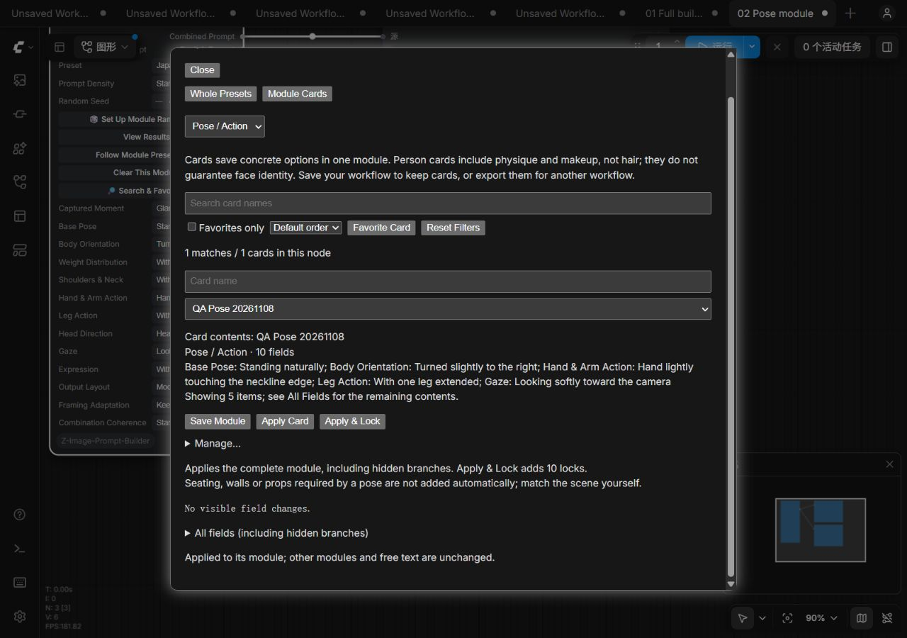

# ComfyUI-Z-Image-Prompt-Builder

English | [Chinese](README.md)

A ComfyUI portrait prompt tool by VividMuse. Choose a preset or combine eight modules to produce natural-language Chinese and English positive prompts. No online service, extra Python dependencies or image model is required.



## Install and update

Run this in ComfyUI's `custom_nodes` directory:

```bash
git clone https://github.com/VividMuse-AGI/ComfyUI-Z-Image-Prompt-Builder.git
```

Restart ComfyUI and force-refresh the browser with `Ctrl+F5`. Find the full node under **VividMuse → Z-Image → Z-Image Prompt Builder**.

For manual installation, download the dedicated package from [GitHub Releases](https://github.com/VividMuse-AGI/ComfyUI-Z-Image-Prompt-Builder/releases) and extract it to `custom_nodes/ComfyUI-Z-Image-Prompt-Builder`. If using an automatic source ZIP with a version suffix, rename its folder accordingly. Do not keep duplicate copies.

For Git installations, run `git pull` inside the node folder, restart and force-refresh. Keep existing workflows; add a fresh node in a separate test workflow to check the interface. See [installation details](docs/user-guide.en.md#installation).

## Quick start

1. Add the full builder, choose a portrait preset and leave fields on **Follow Preset**.
2. Connect **Chinese Prompt** or **English Prompt** to a text encoder, or a text preview for text-only checks.
3. Click ComfyUI **Run**.
4. Click **View Results**, then **Copy Chinese / Copy English**. **More…** contains result JSON export and manual-copy options.

Search ComfyUI Settings for **Z-Image Prompt Builder: Interface language** to choose Chinese or English. Interface language does not change saved fields, prompt text or ports.

## Choose your nodes

| Need | Use |
| --- | --- |
| One preset controlling person, outfit, scene and other modules | Full builder, editing one module at a time |
| Only selected modules, or easy bypass of one section | Eight standalone module nodes connected by text ports; use `Ctrl+B` to bypass |
| Your own full prompts or module fragments | Two standalone TXT nodes; TXT panels are also available in the full builder |

The eight modules are Canvas, Person, Hair, Clothing, Pose & Action, Scene, Photography and Visual Style. Connect the Chinese and English chains separately. TXT nodes preserve original text without translation. See [text-only example workflows](examples/workflows/README.md) and [chaining details](docs/user-guide.en.md#standalone-module-nodes).

## Common tasks

| Task | Entry and behavior |
| --- | --- |
| Add your own description | **Free Prompt** and **Join Position** combine it with structured content |
| Use just one module | Choose **Module to Edit**, then **Enable Only This Module**; confirm clearing when other content exists. Switching the editor alone does not clear anything |
| Prepare random fields | **Set Up Random Combination**, or **Set Up Module Randomness** on a standalone module; then Run |
| Protect person or outfit selections | Right-click **Random Settings & Checks** for module locks; expand field-level locks as needed |
| Save a full configuration or local cards | Right-click **My Presets & Cards → Whole Presets / Module Cards**; imports, exports, rename and delete are under **Manage…** |
| Apply several cards together | Full builder: **My Presets & Cards → Apply Combination**, preview before applying |
| Import TXT | Import and choose entries in **TXT Prompt Library / TXT Module Library**; standalone TXT nodes also offer seeded random selection |
| Find or favorite phrases | **Search & Favorites**; filters affect the list, not random candidates |
| Separate output into paragraphs | Choose **Module Paragraphs** under **Output Layout** on each joining node |
| Set image dimensions | Canvas: aspect ratio, megapixels and divisor; connect width/height outputs to the latent node |

Random setup does not execute the node or guarantee different text each time. Changing only the seed does not make fixed fields random; unlocking also does not enable randomness. **View Draw Result** on standalone TXT nodes shows the selected entry only, excluding preceding text.

## Clear and remove

The full builder's **Clear Content…** offers two scopes, with an explanation before confirmation:

| Action | Clears | Keeps |
| --- | --- | --- |
| Clear Structured Content | Built-in selections and applied user module text | Free Prompt and imported libraries |
| Clear All Prompt Content | The above plus Free Prompt | Imported libraries, resolution calculation settings, seed and locks |

Both actions set the aspect-ratio field to None, so dimensions use the existing fallback rule. Keeping calculation settings does not guarantee unchanged width/height. Saved cards and presets are not deleted.

Local controls remain separate: **Clear Free Prompt** clears only free text; **Clear Current User Module Text** clears that applied fragment; **Remove TXT Prompt Library / Remove TXT Module Library** removes entries but keeps already applied text. Standalone modules retain **Clear This Module**. Clearing a TXT node cannot erase its upstream input.

## Outputs and limits

- The full builder keeps its port order: Chinese Prompt, Recommended Width, Recommended Height, English Prompt. Module ports and connections remain unchanged.
- Built-in fields render in both languages offline. Free Prompt and TXT text remain verbatim; supply English user text for fully English output.
- New nodes default to paragraphs. Existing workflows retain saved layout, fields, seeds and resolution behavior. Language changes do not rewrite prompt text.
- Results are snapshots of actual executions, not previews of current inputs. **Export Result JSON** is not an importable workflow, card or preset. Use the result panel's card-saving section to create cards.
- TXT files are limited to 1 MiB and 500 entries. Libraries are saved in workflows and sent as inputs to the connected ComfyUI server. Check for private material before sharing a workflow.
- Prompts do not guarantee exact identity, anatomy or product details in generated images. Classic nodes and Nodes 2.0 share action semantics; host versions can affect presentation.

## Detailed guides

- [Full user guide](docs/user-guide.en.md): fields, presets, random scopes, dimensions, TXT formats and compatibility
- [Person, Hair, Outfit and Pose Cards](docs/content-cards.md#english), [Shoot Plan Cards](docs/shoot-plan-cards.md#english), [card combinations](docs/card-quick-combination.md#english)
- [TXT result copying and export](docs/txt-result-export.md#english)
- [Full-prompt TXT example](examples/TXT-prompt-library-example.en.txt), [module TXT example](examples/TXT-module-library-example.en.txt)
- [Precise hand actions in development](docs/user-guide.en.md#precise-hand-actions-in-development)

## Development and releases

Python 3.10+ is required. The development target is ComfyUI 0.31.1 or newer; compatibility claims are limited to tested environments.

```bash
python -m unittest discover -s tests -p "test_*.py"
```

Run each `tests/frontend_*.mjs` file with Node for frontend regressions. See [development checks](docs/user-guide.en.md#development-checks).

The published version is **0.19.0**. Interface simplification on this working branch is not released yet. See [CHANGELOG](CHANGELOG.md) and [Releases](https://github.com/VividMuse-AGI/ComfyUI-Z-Image-Prompt-Builder/releases) for version history.

Author: VividMuse · [MIT License](LICENSE)
