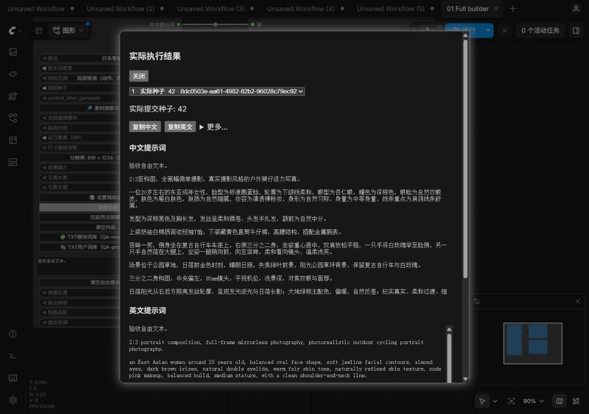

# ComfyUI-Z-Image-Prompt-Builder

[English](README.en.md) | 中文

VividMuse 开发的 ComfyUI 写真提示词工具：选择预设或组合八个模块，输出中文、英文自然语言正向提示词。无需在线服务、额外 Python 依赖或生图模型。



## 安装与更新

在 ComfyUI 的 `custom_nodes` 目录执行：

```bash
git clone https://github.com/VividMuse-AGI/ComfyUI-Z-Image-Prompt-Builder.git
```

重新启动 ComfyUI 并按 `Ctrl+F5` 刷新浏览器。完整节点位于 **VividMuse → Z-Image → Z-Image 中文提示词生成器**。

手动安装请从 [GitHub Releases](https://github.com/VividMuse-AGI/ComfyUI-Z-Image-Prompt-Builder/releases) 下载专用安装包，解压到 `custom_nodes/ComfyUI-Z-Image-Prompt-Builder`。自动生成的源码 ZIP 若带版本后缀，应将目录改为上述名称；不要保留多个副本。

Git 安装在节点目录执行 `git pull` 更新，再重启并强制刷新。保留现有工作流，另建测试工作流检查界面即可，无需删除原节点。详见[安装说明](docs/user-guide.md#安装)。

## 最短使用流程

1. 添加完整节点，选择写真预设，字段先保留“跟随预设”。
2. 将“中文提示词”或“英文提示词”接到文本编码节点；仅检查文字时可连接文本预览。
3. 点击 ComfyUI **Run**。
4. 点击节点的 **查看结果**，使用 **复制中文／复制英文**；导出结果 JSON 和手动复制在 **更多…** 中。

在 ComfyUI 设置中搜索 **Z-Image Prompt Builder: Interface language** 可切换中文或 English。界面语言不改变保存的字段、提示词或输出端口。

## 选择哪种节点

| 需求 | 使用方式 |
| --- | --- |
| 一套预设统一管理人物、穿搭、场景等 | 完整节点，一次只编辑一个模块 |
| 只用部分模块，或需要旁路某一段 | 八个独立模块节点；通过文本端口串联，用 `Ctrl+B` 旁路 |
| 使用自己的整段提示词或模块短语 | 两个独立 TXT 词库节点；完整节点也内置 TXT 面板 |

八个模块为：画面基础、人物、发型、服装、姿态动作、场景、摄影、视觉表现。中文链和英文链分别连接；TXT 节点保留输入原文，不自动翻译。参考[纯文本示例工作流](examples/workflows/README.md)与[串联说明](docs/user-guide.md#独立模块节点)。

## 常见任务

| 想做什么 | 入口与行为 |
| --- | --- |
| 补充自己写的描述 | “自由提示词”＋“拼接位置”；与结构化内容自动拼接 |
| 只使用某一个模块 | 选择“当前编辑模块”→“仅启用当前模块”；有其他内容时确认清空范围。仅切换编辑模块不会清空 |
| 设置随机内容 | **设置随机组合**；独立模块用 **设置本模块随机**。按范围准备字段，再 Run 查看结果 |
| 保护人物或穿搭不被随机改动 | 右键 **随机设置与检查**，锁定模块；字段级锁定按需展开 |
| 保存整套配置或局部卡片 | 右键 **我的预设与卡片** → **整套预设／模块卡片**；导入、导出、重命名、删除在“管理…” |
| 一次应用多个卡片 | 完整节点：**我的预设与卡片 → 组合应用**，先预览再应用 |
| 导入 TXT | **TXT 用户词库／TXT 模块词库**中导入并选择条目；独立 TXT 节点另支持按种子随机抽取 |
| 搜索或收藏短语 | **素材搜索与收藏**；筛选只影响列表，不限制随机候选 |
| 分段输出 | “输出排版”选择“按模块分段”；串联时每个拼接节点分别设置 |
| 设置实际尺寸 | 画面基础：比例＋百万像素（MP）＋整除倍数，并连接宽高输出到 latent |

随机按钮不立即执行，也不保证每次得到不同文字。只改种子不会把固定字段变为随机；解除锁定也不会自动随机。TXT 独立节点的 **查看抽取结果** 只显示抽中的条目，不含前置拼接文本。

## 清空与移除

完整节点的 **清空内容…** 提供以下两个选项，核对说明后确认：

| 操作 | 清除 | 保留 |
| --- | --- | --- |
| 清空结构化内容 | 内置字段、已应用用户模块文本 | 自由提示词、已导入词库 |
| 清空全部提示词 | 上述内容及自由提示词 | 已导入词库、尺寸计算设置、种子及锁定配置 |

这两个操作会把画面比例字段设为“不使用”，尺寸输出沿用原有比例兜底规则；保留尺寸计算设置不代表宽高一定不变。已保存卡片和预设不会被删除。

就近操作保持独立：**清空自由提示词**只清自由文本；**清空当前用户模块文本**只清所选用户模块；**移除 TXT 用户词库／移除 TXT 模块词库**只移除条目列表，保留已应用文本。独立模块保留直接“清空本模块”按钮。清空 TXT 节点不会删除上游输入。

## 输出与重要限制

- 完整节点端口顺序仍为中文提示词、推荐宽度、推荐高度、英文提示词；八个模块保留原端口及连接方式。
- 内置字段离线渲染为中英文；自由提示词和用户 TXT 始终原样保留。需要纯英文输出时，请提供英文用户文本。
- 新节点默认按模块分段；旧工作流保留原排版、字段、种子和尺寸规则。切换界面语言不会迁移或重写正文。
- 结果记录为实际执行的快照，不是当前输入预览。**导出结果 JSON**不能作为工作流、卡片或用户预设导入；保存卡片请使用结果面板的卡片保存区。
- 两类 TXT 文件限制为 1 MiB、500 条。词库随工作流保存，并作为输入发送给连接的 ComfyUI 服务端；公开工作流前请检查是否含私人内容。
- 节点提供提示词，不保证生图模型准确还原身份、人体动作或商品细节。经典与 Nodes 2.0 的界面共用动作语义；宿主版本可能影响展示。

## 详细说明

- [完整使用手册](docs/user-guide.md)：字段、预设、随机范围、分辨率、TXT 格式和兼容规则
- [人物／发型／穿搭／姿态动作卡](docs/content-cards.md)、[拍摄方案卡](docs/shoot-plan-cards.md)、[卡片组合应用](docs/card-quick-combination.md)
- [TXT 抽取结果复制与导出](docs/txt-result-export.md)
- [完整提示词 TXT 示例](examples/TXT词库示例.txt)、[模块 TXT 示例](examples/TXT模块词库示例.txt)
- [开发中的精确手部动作](docs/user-guide.md#精确的手部动作开发中)

## 开发与版本

要求 Python 3.10+。开发测试目标为 ComfyUI 0.31.1 及以上；支持范围以实际测试环境为准。

```bash
python -m unittest discover -s tests -p "test_*.py"
```

前端回归逐个运行 `node tests/frontend_*.mjs` 中的脚本。完整命令见[开发测试](docs/user-guide.md#开发测试)。

当前已发布版本：**0.19.0**。本工作分支的界面整理尚未发布；历史功能与版本说明见 [CHANGELOG](CHANGELOG.md) 和 [Releases](https://github.com/VividMuse-AGI/ComfyUI-Z-Image-Prompt-Builder/releases)。

作者：VividMuse · [MIT License](LICENSE)
