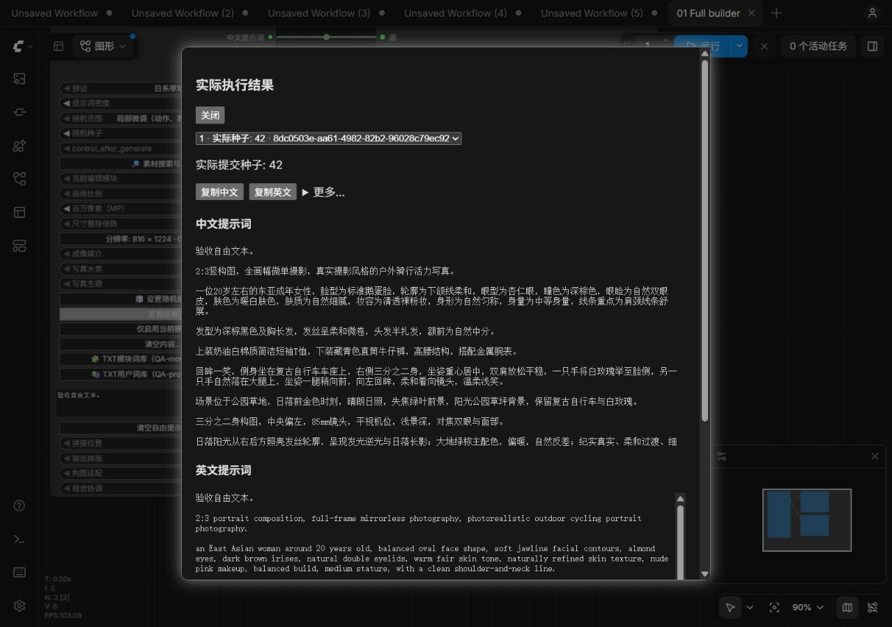
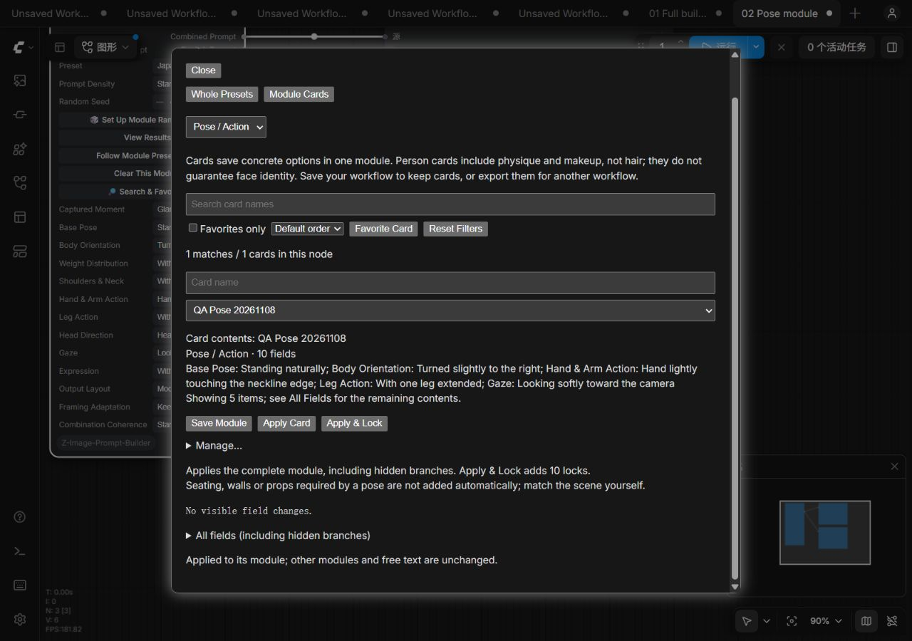

# 界面精简合并验收

日期：2026-11-08；人工验收收尾：2026-11-10。

## 结论

三个阶段的代表性界面及纯文本联调通过，合并回归为 38 个前端脚本、321 个 Python 测试全部通过。2026-11-10 用户在重新打开的 8203 测试页确认“复制和取消都没有问题”，系统粘贴和“仅启用当前模块”原生确认取消两项关闭，本轮界面验收完成。

本轮仅补充文档和截图，没有修改运行代码、版本号，没有安装到生产节点或提交发布。

## 环境和范围

- 源码：`txt-library-test-clone` 工作区，包含未发布的前三阶段修改。
- 独立地址：`http://127.0.0.1:8203/`。
- 副本与证据：工作区 `audits/ui-simplification-20261108/`。
- 宿主 ComfyUI 0.44.2、Python 3.11.9，CPU 纯文本执行；未加载模型或运行生图。
- 启动前记录 202 个复制文件的校验值，服务端 25 个前端脚本与测试副本逐一匹配。随后只更新文档和截图，运行脚本没有再改动。
- 布局检查使用 1280×900 CSS 像素视口，检查后已恢复默认视口及中文自动语言、经典节点模式。
- 仅操作四份新建测试工作流，没有执行、关闭或丢弃原有未保存工作流。

## 实机检查

| 项目 | 观察结果 |
| --- | --- |
| 完整节点文本输出 | 默认预设及自由文本都进入中英文输出；用户自由文本原样保留 |
| 结果正文前置 | 900 像素高视口首次打开即可看到中文正文、复制中文／英文和更多；诊断及保存卡片默认折叠 |
| 手动复制 | 更多入口可展开对应语言只读文本，提示选择文本而非声称系统复制完成 |
| 清空结构化 | 执行后两个预览只保留“验收自由文本。”，结构化字段变为不使用 |
| 清空全部提示词 | 执行后两种输出为空；两类导入库仍分别保留 2／3 条记录 |
| 清空取消 | 自定义清空弹窗取消可关闭；完整零修改断言由自动化覆盖 |
| 仅启用当前模块 | 实际运行只输出当前画面基础；原生确认框点击发生工具超时，不能据此证明取消分支正常 |
| 统一管理入口 | 完整节点为整套预设／模块卡片／组合应用三个页签，切换不新增叠加管理弹窗 |
| 独立姿态卡 | 仅显示支持的卡片类型，无组合页签；可保存并应用一次性测试卡 |
| 宿主撤销重做 | 清空姿态模块后应用卡；Ctrl+Z 恢复十个空字段，Ctrl+Y 恢复十个卡片字段 |
| TXT 用户词库 | 固定种子 42 抽出“窗边自然光照亮人物。”；结果面板正文及操作前置 |
| TXT 模块词库 | 人物模块固定种子 42 抽出“一位30岁左右的成年女性。”；未混入场景模块条目 |
| TXT 文案与模式 | 中英文移除词库和清空文本名称不同；随机模式保持手动应用／文本清空禁用规则 |
| 语言和节点模式 | 中文／英文经典节点、中文／英文 Nodes 2.0 代表布局正常；英文长操作名可读，无占位控件或异常长空白 |
| 浏览器错误 | 本次检查时错误日志列表为空 |

姿态测试用于检查卡片字段和事务恢复，不是照片效果或全部组合语义验收。没有对所有字段重复四套界面测试。

## 回归与文档

合并源码复跑 `tests/frontend_*.mjs` 共 38 个脚本，无失败；`python -m unittest discover -s tests -p "test_*.py" -q` 共 321 项通过。测试运行时为 Node.js 22.20.0 和 Python 3.10.11，区别于上述 ComfyUI 宿主运行时。

示例工作流说明中遗漏的旧菜单名已更新为“我的预设与卡片”“随机设置与检查”“查看结果”和“更多 → 导出结果 JSON”，英文同步。README 新增下面两张实机截图。

其余英文经典、英文 Nodes 2.0 完整节点、中文 Nodes 2.0 完整节点、英文 TXT 结果截图保存在上述本地证据目录。

## 人工补验已完成

在独立 8203 页、`01 Full builder` 测试工作流中完成，不需要生图：

1. 在结果面板亲自点击“复制中文”，立即粘贴到记事本核对；再单独点击“复制英文”并粘贴核对。工具未调用虚拟剪贴板接口，也未读取系统剪贴板；两次复制请求成功不等于系统粘贴已验证。
2. 关闭结果面板，在完整预设仍含多模块内容时点击“仅启用当前模块”。确认提示应说明保留画面基础、清除其他模块；点击“取消”，重新运行后应仍保留人物、服装等原正文。

以上两项由用户于 2026-11-10 确认正常，不将人工确认写成工具读取系统剪贴板的结果。界面验收已关闭，后续只做候选提交范围及干净副本检查，再确认发布版本与授权。
